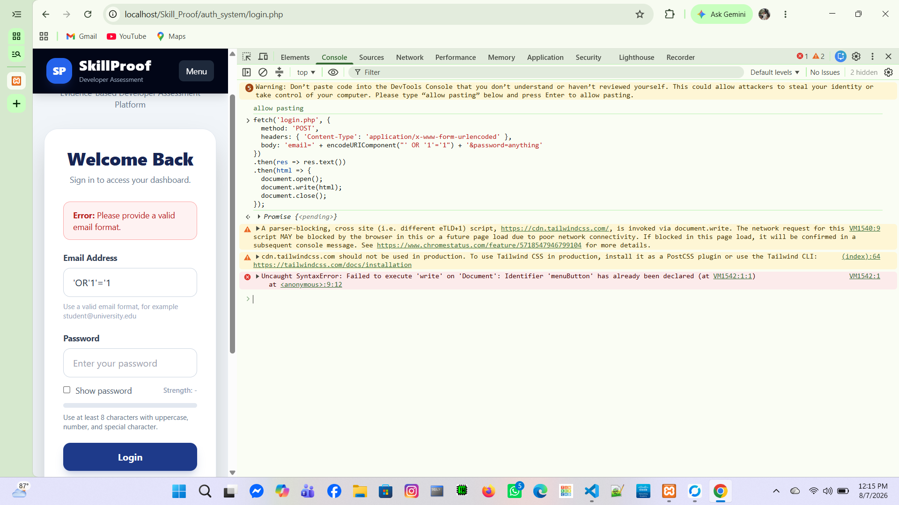
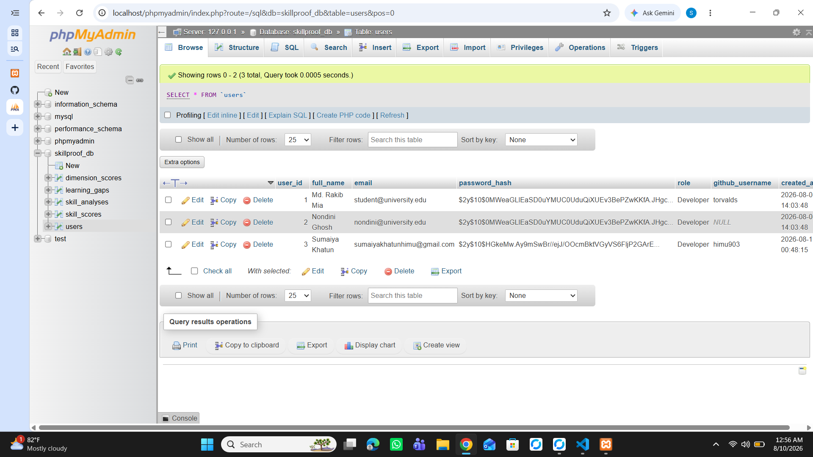
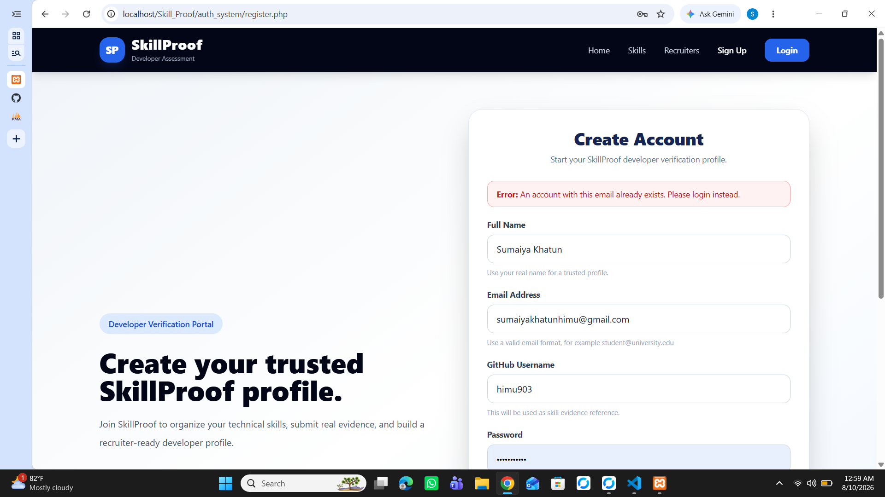

# Week 6 — Database Integration & Web Application Security: Proof of Work

## Nondini — Login / SQL Injection Defense
**File(s):** `auth_system/login.php`
**Branch:** `feature/week6-login-security-nondini`

- [x] Confirmed `$pdo->prepare()` used for the login query (no string concatenation)
- [x] Confirmed `password_verify()` used to check the password
- [x] Confirmed `session_regenerate_id(true)` runs on successful login
- [x] Tested SQLi payload `' OR '1'='1` in the email field → login correctly rejected

**Evidence:**

## 3. Sumaiya — Registration / Password Hashing
**File(s):** `auth_system/register.php`
**Branch:** `feature/week6-register-security-sumaiya`

- [x] Confirmed `password_hash($password, PASSWORD_DEFAULT)` used before insert
- [x] Confirmed duplicate-email check uses a prepared statement
- [x] Confirmed input validation (name, email format, password length ≥ 8)
- [x] Verified in phpMyAdmin that `password_hash` column stores a bcrypt hash
      (e.g. `$2y$10$...`), never plaintext

**Evidence:**

